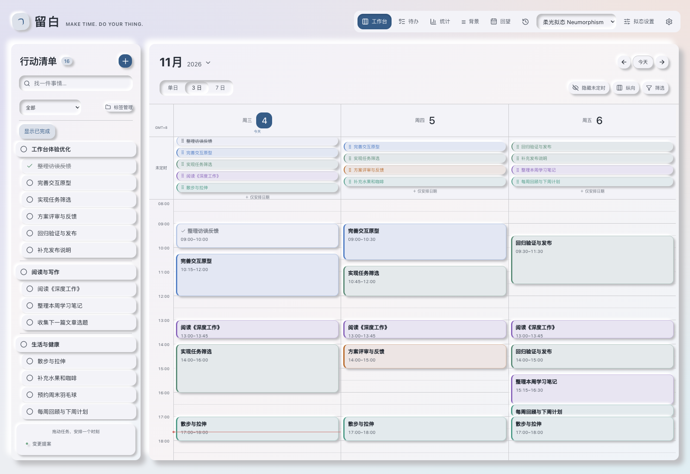
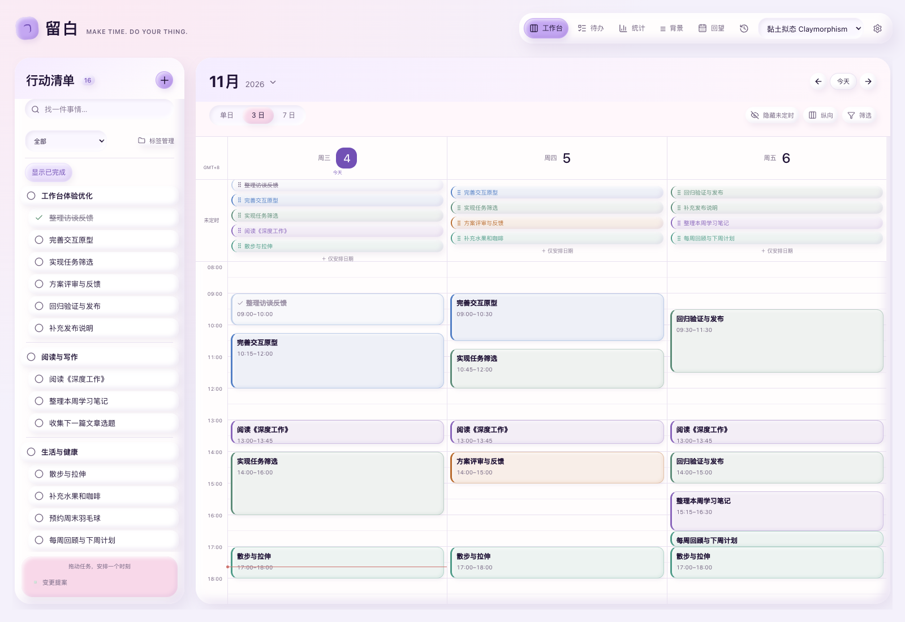
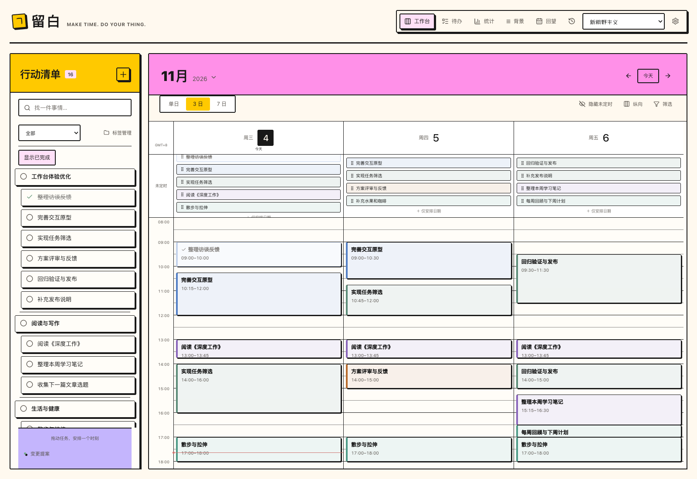
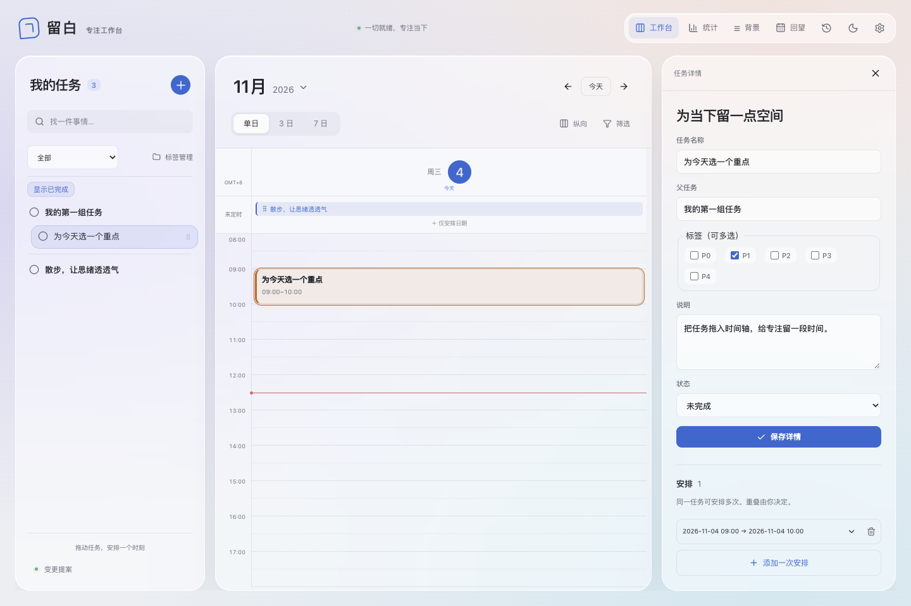
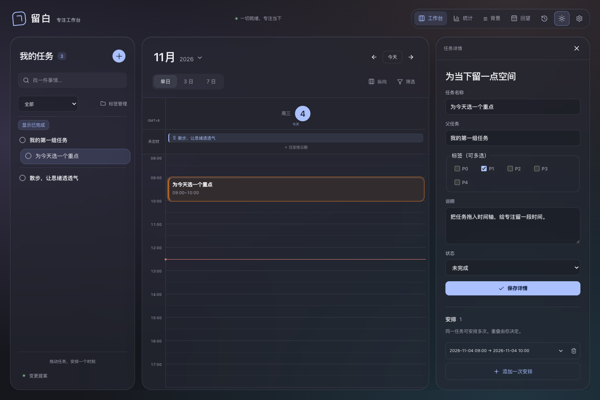
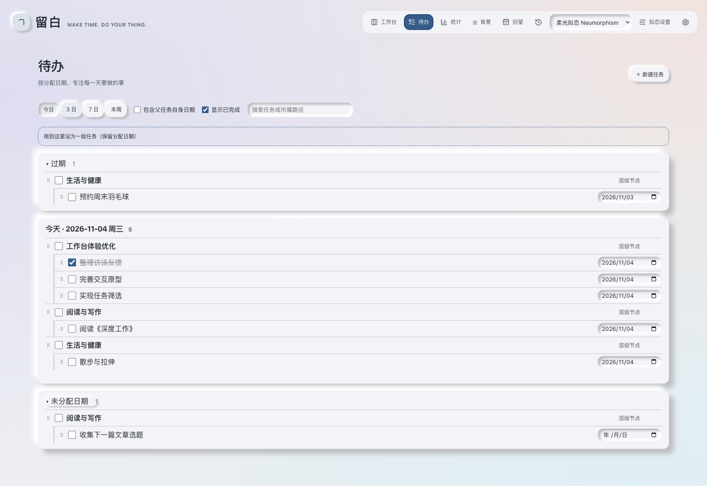
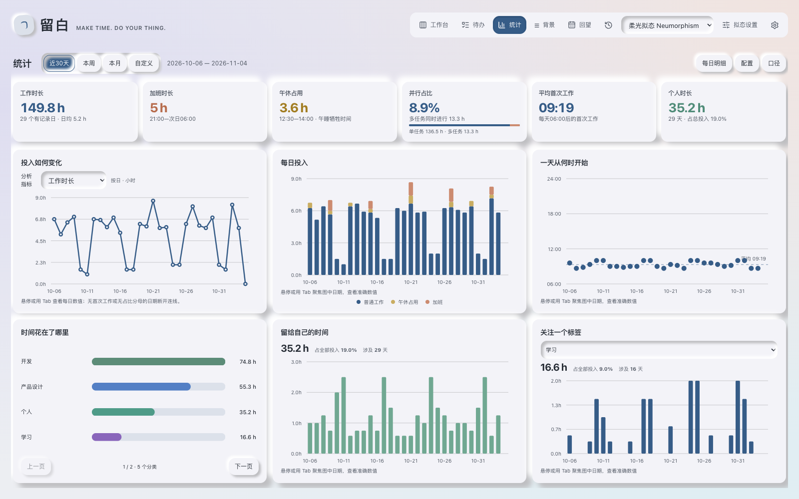

# 留白 · 个人专注工作台

## 文档的关键结论

**给专注留一点空间。**

留白是一张运行在本机的个人工作台：把想做的事放下来，为重要的事安排时间，再留下一点回望。极简的日常体验、纯文件化的数据，以及能与你一起整理计划的 AI，让安排生活这件事更轻一点。

**多主题工作台 · JSON / Markdown · AI 友好 · 本机运行**

支持 **柔光拟态、黏土拟态、新粗野主义、晨光玻璃、夜色玻璃** 五种主题，覆盖柔和立体、鲜明色块与深浅玻璃等不同风格。各风格拥有自己的材质与布局，共用同一份任务、标签和排期，可以按喜好随时选择。

[开始使用](#开始使用) · [支持的主题](#支持的主题) · [待办与统计](#待办与统计) · [使用指南](docs/USER-GUIDE.md) · [AI 协作指南](docs/AI-USAGE.md)



*默认的柔光拟态主题。使用日常模拟数据真实渲染，展示项目任务、阅读写作与生活安排。*

## 支持的主题

**一份计划，五种视觉体验。** 默认使用柔光拟态的晨光暖白配色。在顶部「界面风格」中选择主题，选择会保存，刷新或重启后继续生效。

| 主题 | 视觉特点 | 布局特点 |
| --- | --- | --- |
| 晨光玻璃 | 浅色、半透明表面、柔和阴影 | 可调整任务面板宽度的工作台 |
| 夜色玻璃 | 深色、玻璃材质、低亮度背景 | 与晨光玻璃共用布局 |
| 新粗野主义（Neobrutalism） | 粗黑描边、硬阴影、加粗标题、鲜艳色块 | 独立布局，固定任务栏与详情浮层 |
| 柔光拟态（Neumorphism） | 晨光暖白、柔和凸起与内凹光影，可调整材质参数 | 固定任务栏与详情浮层 |
| 黏土拟态（Claymorphism） | 浅紫与柔粉、大圆角、内高光与柔软立体阴影 | 固定任务栏与详情浮层，紧凑待办列表 |

**不同风格独立维护界面，共用同一套业务能力与数据。** 切换主题不会复制或更改任务、标签与排期；新增风格不会替换旧风格。柔光拟态还支持自定义底色、强调色、圆角与光影，让工作台更贴近自己的偏好。

为保护未保存内容，编辑区域或弹窗打开、拖拽与保存期间暂不可切换。请先完成编辑并关闭区域，再选择其他主题。新粗野主义与黏土拟态目前提供浅色版本。

### 主题样例

以下截图与首图使用同一组日常模拟数据：16 个任务、30 条日期与时段安排，包含项目层级、已完成事项、未定时任务和三日时间轴。五种主题使用相同窗口尺寸与排期，便于对比实际效果；点击图片可查看大图。

| 黏土拟态 · Claymorphism | 新粗野主义 · Neobrutalism |
| --- | --- |
| 浅紫柔粉、大圆角与柔软立体阴影 | 粗黑描边、硬阴影与鲜艳色块 |
| [](docs/images/workbench-claymorphism.png) | [](docs/images/workbench-neobrutalism.png) |

| 晨光玻璃 | 夜色玻璃 |
| --- | --- |
| 浅色半透明表面与柔和阴影 | 深色玻璃材质与低亮度背景 |
| [](docs/images/workbench-light.png) | [](docs/images/workbench-dark.png) |

## 极简，从今天的一件事开始

把脑中的事先放下来，再决定什么时候做。可以只安排到某一天，也可以拖入时间轴，为它留出一段专注时间。

- **把大事拆小。** 任务可以逐层拆分，用标签标记重点，也能快速搜索。
- **让计划看得见。** 拖动安排、拉伸时长；单日、三日、七日视图，按自己的节奏切换。
- **给变化留余地。** 同一任务可以安排多次，删除某次安排仍保留任务。
- **为一天留一句话。** 每日回望与独立笔记记录想法，统计帮助你回顾时间投入。

初次打开是一张空白工作台。你可以从自己的第一件事开始，也可以点击「先体验一组示例」试一试。

## 待办与统计

除了时间轴工作台，还可以从顶部进入「待办」与「统计」：一个帮你梳理要做的事，一个帮你回顾时间花在了哪里。

- **待办：按日期整理任务。** 支持今日、3 日、7 日和本周视图，集中查看过期与未分配日期的事项；保留任务层级，可搜索、勾选完成、行内改名，或拖拽调整日期与归属。
- **统计：回顾时间投入。** 支持近 30 天、本周、本月和自定义范围，展示工作与个人时长、每日趋势、加班、午休占用及标签分布，并可展开每日明细。统计基于已发生的定时安排，今日截至当前时间；未定时安排不计入时长。

下图选用柔光拟态展示两个页面的真实渲染：待办沿用工作台的日常模拟任务，展示过期、今日、已完成和未分配日期的事项；统计使用覆盖 92 天、351 条任务的模拟数据，展示长期使用后的近 30 天投入趋势。所有截图均为演示数据，并非真实个人记录。点击图片可查看大图。

| 待办 · 每天要做什么 | 统计 · 时间花在哪里 |
| --- | --- |
| [](docs/images/todo-neumorphism.png) | [](docs/images/statistics-neumorphism.png) |

## 纯文件化，你的数据就在文件夹里

任务、背景、日记和修改历史都以本机文件保存。无需安装数据库，也无需注册工作台云端账户；离开界面，你仍然可以用文本编辑器阅读自己的内容。

```text
data/
├── workspace.json       任务、标签与时间安排
├── preferences.json     你的界面偏好
├── ai/
│   ├── long-term.md      长期背景
│   └── short-term.md     近期安排
├── reflections/
│   ├── daily/           每日回望
│   └── notes/           独立笔记
└── .history/changes/    修改历史
```

**文件既是存储，也是可读的内容。** JSON 让任务结构清晰，Markdown 让背景与日记容易阅读，也让 AI 有明确的上下文可用。

规范写入会留下前后内容，支持预览恢复。备份时关闭服务，一起复制 `data/` 和配套 `.local/`；详细规则见 [文件、备份与恢复](docs/USER-GUIDE.md#文件备份与恢复)。

## AI 友好，让对话接上你的计划

在项目目录打开 Codex，就能围绕已有任务、长期背景、近期安排和日记继续讨论。工作台提供统一的命令入口，让 AI 读取上下文、提出调整，并在你确认后保存。

你可以这样发起对话：

> 看看我这周的安排，帮我给写作留出两段专注时间，先展示调整方案。
>
> 读一下我最近关于睡眠的日记，帮我总结反复出现的问题。


**AI 帮你整理，你决定是否落笔。** 也可以直接在网页里管理任务、查看提案与修改历史。

工作台无需配置模型密钥，模型登录和额度由 CLI 管理。文件保存在本机；使用 AI 时，读取的内容会进入所用 CLI 的模型上下文。当前正式验收入口为 Codex，其他 CLI 的接入说明见 [AI 协作指南](docs/AI-USAGE.md)。

## 开始使用

准备 Node.js **22.12 或更新版本**与 npm，在项目目录运行：

```sh
npm ci
npm run build
npm start
```

在浏览器打开 [本机工作台](http://127.0.0.1:4310)。首次构建后，日常只需 `npm start`，按 `Ctrl+C` 关闭服务。

当前面向**桌面、本机、单人使用**，暂不包含循环任务、提醒、多设备同步或完整手机适配。时区固定为 `Asia/Shanghai`。

## 进一步了解

| 想了解什么 | 从这里开始 |
| --- | --- |
| 任务、排期、标签与日常操作 | [使用指南](docs/USER-GUIDE.md#日常使用) |
| 与 AI 协作、命令和确认规则 | [AI 协作指南](docs/AI-USAGE.md) |
| 备份、历史恢复与外部文件修改 | [数据维护](docs/USER-GUIDE.md#文件备份与恢复) |
| 本地开发与启动配置 | [启动与开发](docs/USER-GUIDE.md#启动与开发) |
| CLI AI 工作流设计 | [v0.5.0 功能计划](docs/plans/v0.5.0_cli-ai-workflow_functional-plan.md) · [代码开发方案](docs/plans/v0.5.0_cli-ai-workflow_technical-plan.md) |

## 多风格界面维护

v0.8.0 / claymorphism-theme：[功能计划](docs/plans/v0.8.0_claymorphism-theme_functional-plan.md) · [技术方案](docs/plans/v0.8.0_claymorphism-theme_technical-plan.md)。

v0.6.0 / neobrutalism-theme：[功能计划](docs/plans/v0.6.0_neobrutalism-theme_functional-plan.md) · [技术方案](docs/plans/v0.6.0_neobrutalism-theme_technical-plan.md)。

`src/client/presentations/glass`、`neobrutalism`、`claymorphism` 与 `neumorphism` 分别维护页面入口、布局、配色和样式；同族深浅玻璃共享页面。`application/useWorkbench` 管理公共数据与操作，`App` 负责装配。共享控件通过 `Appearance` 获取样式，可由新的界面选择复用或替换，不得互相导入其他风格的页面或 CSS。

新增风格应在自己的目录实现界面与样式，在装配入口和主题注册表登记，并扩展当前偏好类型与校验；不要修改冻结的历史校验。执行公共功能测试、风格依赖隔离与样式契约测试，并分别验收所有界面的主要流程。当前编辑草稿保留在控件内，因此切换前必须关闭编辑区域；不会自动跨不同界面迁移未保存表单。

## 柔光拟态与外观配置

v0.9.0 / neumorphism-theme：[功能计划](docs/plans/v0.9.0_neumorphism-theme_functional-plan.md) · [技术方案](docs/plans/v0.9.0_neumorphism-theme_technical-plan.md)。

选择「柔光拟态 Neumorphism」后，点击主题选择器旁的「拟态设置」，在右侧抽屉调整底色、强调色、圆角、凸起距离、阴影强度、柔和度和光源方向。修改实时预览，点击保存后刷新仍保留；取消、关闭或 Escape 恢复打开前外观。「恢复默认」先预览，保存后生效。窄窗口下抽屉全宽显示，编辑任务或保存期间不可打开。

新风格独立位于 `src/client/presentations/neumorphism`，配置沿用偏好文件保存，不改变任务数据。底色限定浅色，各 RGB 通道至少为 180；其他参数具有范围限制。

v0.10.0 / liquid-glass-theme：[功能计划](docs/plans/v0.10.0_liquid-glass-theme_functional-plan.md) · [技术方案](docs/plans/v0.10.0_liquid-glass-theme_technical-plan.md)。在「界面风格」中选择「液态玻璃 Liquid Glass」，即可启用浅色透光面板、边缘高光与胶囊控件；选择会保存并在刷新后恢复。保留现有默认主题。
